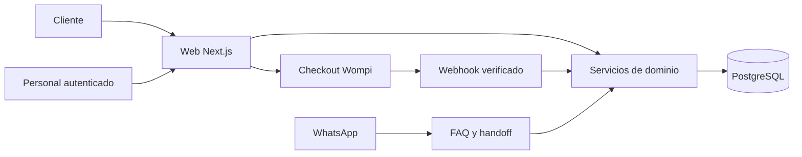

# Arquitectura y estructura del repositorio

## Decisión S14

Un monolito modular Next.js sirve páginas, API y administración. PostgreSQL es la fuente única de reservas, disponibilidad y pagos; Supabase proporciona base de datos y autenticación interna. Se elige para reducir servicios y mantener las operaciones de reserva dentro de una transacción. El PM no prescribe stack; esta es una decisión S0.

| Capa | Selección | Responsabilidad |
|---|---|---|
| Web y servidor | Next.js App Router 16, React compatible, TypeScript estricto | Páginas indexables, formularios, handlers y admin |
| Runtime | Node.js 22, pnpm 10 | Fijar patch y lockfile al iniciar S1 |
| Estilos | CSS Modules y variables CSS | Identidad provisional sin sistema visual complejo |
| Validación | Zod | Contratos comunes cliente/servidor; servidor autoritativo |
| Persistencia | PostgreSQL 17, Supabase | Migraciones SQL, claves y exclusiones transaccionales |
| Acceso SQL | `pg`, solo en servidor | Transacciones explícitas; tipos generados desde esquema |
| Auth | Supabase Auth | Invitación de personal; MFA exigido para admin en producción |
| Hosting previsto | Vercel para Next.js, Supabase para datos | Proyectos separados de staging y producción |
| Pago | Wompi Checkout hospedado | Anticipo estándar; no almacenar datos de tarjeta |
| WhatsApp | Meta WhatsApp Business Cloud API | Mensajes entrantes, FAQ y derivación a personal |
| IA | Adaptador FAQ con modelo configurable | Solo respuestas fundadas en FAQ aprobada; sin autoridad de pago |
| PDF | `@react-pdf/renderer` en servidor | Snapshot de cotización; no factura electrónica |
| Medición | GTM con GA4 y Google Ads | Eventos definidos en documento 09 |
| Pruebas | Vitest, Playwright y PostgreSQL de prueba | Fórmulas, transacciones, permisos y recorrido web |

No se afirma que estas versiones sean las últimas. S1 debe fijar releases compatibles y sin alertas de seguridad conocidas en el momento de instalación. Si el proveedor no permite PostgreSQL 17, registrar la versión disponible compatible y repetir pruebas de restricciones; no cambiar la política de negocio. No añadir librerías/servicios ajenos al alcance por defecto.

El proveedor/modelo específico del adaptador de lenguaje se elige al implementar WhatsApp, con costos y cuenta reales. El contrato es fijo e intercambiable: entrada FAQ aprobada + mensaje sin datos de pago, salida respuesta o handoff. Hasta habilitarlo, FAQ determinista y atención humana; no presentar ese fallback como IA terminada. S1 no necesita una cuenta de IA.

## Flujo de dependencias



Servicios de dominio: `leads`, `pricing`, `availability`, `quotes`, `bookings`, `payments`. Adaptadores externos no escriben inventario directamente. Una única función transaccional aplica cada comando de hold, confirmación o liberación. La interfaz pública nunca usa credenciales privilegiadas.

## Estructura de implementación prevista

```text
03_ALQUILER_TECH/
  README.md
  AGENTS.md
  docs/                         # copiar especificaciones de este paquete
  config/                       # tarifas versionadas y políticas
  .env.example
  package.json                  # crear en S1
  pnpm-lock.yaml                # crear y fijar en S1
  src/
    app/
      (public)/                 # rutas de catálogo, cotizador y políticas
      (admin)/admin/            # rutas protegidas
      api/v1/                  # contratos del documento 07
      api/webhooks/wompi/
      api/webhooks/whatsapp/
    components/                # presentación y formularios
    domain/
      leads/
      availability/
      pricing/
      quotes/
      bookings/
      payments/
    server/
      db/
      auth/
      integrations/wompi/
      integrations/whatsapp/
      pdf/
      telemetry/
    content/                   # catálogo editorial y FAQ aprobada
    lib/                       # dinero, fechas y contratos de validación
  supabase/migrations/
  supabase/seed.sql             # fixtures ficticios solo dev
  tests/unit/
  tests/integration/
  tests/e2e/
  public/
  .github/workflows/ci.yml
```

Este árbol es una especificación, no carpetas llenas de implementaciones vacías. No crear módulos de fases futuras para «dejarlos listos». El paquete presente está en `sprint-0/` para respetar el espejo de las fuentes; el repo de desarrollo podrá importar estos documentos sin incorporar datos personales ni credenciales.

## Entornos y seguridad

Dev y staging: cuentas/pagos test, datos sintéticos, `noindex`, sin conversiones de Ads de producción. Producción: proyecto y secretos propios, tarifas aprobadas y gates completos. Ningún seed crea inventario productivo ficticio. Variables privadas nunca llevan prefijo `NEXT_PUBLIC_`.

API pública accede a servicios del servidor; RLS deniega por defecto lectura directa de tablas personales. Auth valida sesión y rol en cada operación de admin. Funciones con privilegios elevados comprueban permisos y tienen `search_path` fijo. Enlaces públicos usan 32 bytes aleatorios; guardar hash, no token en logs. Tokens de cotización vencen con ella; token de reserva, 30 días después del evento, revocable por admin.

Validar body, tamaños y tipos; limitar captación a 10 solicitudes/IP/minuto y checkout a 5/cotización/minuto (S0, ajustar por evidencia). Proteger mutaciones autenticadas frente a CSRF y no confiar en el precio enviado por el cliente. Logs estructurados con IDs, sin correo/teléfono, secretos ni contenido completo de chats. En analítica nunca incluir PII ni tokens públicos.

## Operabilidad mínima

Mantener registro durable de webhooks recibidos y comandos aplicados. Un fallo después de recibir pago debe ser reintentable sin duplicar reserva. Limpieza de holds cada minuto más limpieza dentro de cada transacción de asignación; cron atrasado no autoriza sobreventa. Conciliación manual de pagos pendientes al menos diaria durante piloto y después de incidentes; la reserva no depende de email o WhatsApp exitoso.

Respaldo diario y ensayo de restauración antes de producción. Objetivos S0: RPO de 24 h para recuperación general y RTO de 4 h; tras restauración, ventas pausadas hasta conciliar pagos con proveedor y reservas operativas posteriores al respaldo. Si el plan contratado no soporta respaldo/exportación, no abrir cobros hasta establecerlo.

CI: instalación con lockfile, lint, tipos, pruebas pertinentes, build. Nunca migrar producción automáticamente desde preview. Migraciones aditivas y rollback de aplicación; respaldo antes de cambios destructivos. Revisión de logs y errores de pago visible en admin, sin instalar BI/observabilidad compleja.

## Referencias técnicas verificadas

Las fuentes oficiales complementan implementación, no cambian el negocio. Consultadas durante Sprint 0:

- [Next.js Installation](https://nextjs.org/docs/app/getting-started/installation): base App Router y requisitos de instalación.
- [Supabase Row Level Security](https://supabase.com/docs/guides/database/postgres/row-level-security): control de acceso por fila.
- [PostgreSQL Range Types](https://www.postgresql.org/docs/current/rangetypes.html): intervalos y exclusión de solapamientos.
- [Wompi Eventos Colombia](https://docs.wompi.co/docs/colombia/eventos/): firma y notificaciones separadas por entorno.
