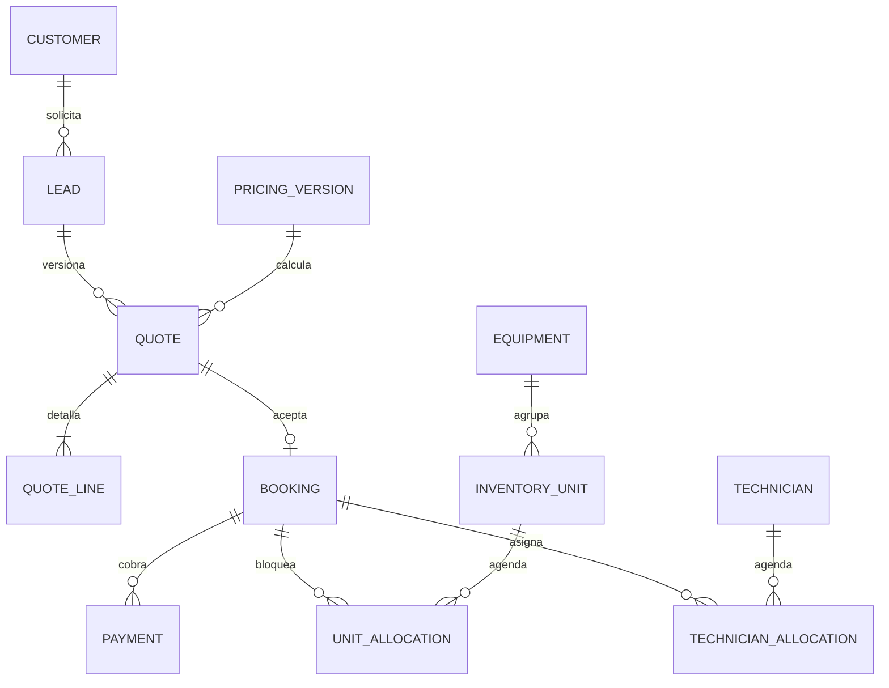

# Modelo de datos v0

## Convenciones

Decisión S0 a partir de las ocho entidades de PM §14. Identificadores UUID; fechas `timestamptz` UTC y representación de evento en `America/Bogota`; moneda únicamente COP. Dinero en pesos enteros `bigint`, nunca float. Tasas en puntos básicos `int`. PK `id`, `created_at` y `updated_at` obligatorios salvo registros append-only. `?` indica nullable; el resto es obligatorio. FK con borrado RESTRICT en relaciones financieras. No borrar reservas/pagos para corregir errores.

Estados se restringen con CHECK/enum. Los snapshots JSONB de importes, costos y reglas son inmutables una vez emitidos. Todos los campos de costos y notas internas son privados. Las tablas auxiliares se justifican por reserva segura, no por ERP.

## Diccionario

| Tabla | Campos específicos mínimos | Claves y restricciones |
|---|---|---|
| `equipment` | code text, name text, category text, active bool | code único QUEST2/QUEST3; category=vr en v0 |
| `inventory_unit` | equipment_id FK, asset_tag text, serial text?, status, inspected_at timestamp?, accessories jsonb, is_fixture bool | asset_tag único; serial único cuando existe; producción exige serial e inspección para status=ready |
| `customer` | company_name text?, contact_name text, email_normalized text, phone_e164 text, customer_type, billing_details jsonb?, marketing_consent bool | email_normalized único v0; empresas con varios contactos no se fusionan por nombre |
| `lead` | customer_id FK, owner_user_id FK?, stage, request jsonb, source text, attribution jsonb, estimated_value_cop bigint?, loss_reason text?, next_action_at timestamp?, privacy_version text, privacy_accepted_at timestamp, continuation_token_hash text, continuation_expires_at timestamp, automation_mode | una fila por oportunidad; request preserva valores recibidos; automation_mode=faq/human |
| `lead_note` | lead_id FK, author_user_id FK, body text | append-only para trazabilidad |
| `pricing_version` | version text, mode, rules jsonb, rules_hash text, approved_by FK?, approved_at timestamp?, cost_evidence_ref text?, active bool | version única; mode=sandbox/production; producción exige aprobación/evidencia |
| `quote` | lead_id FK, version int, status, pricing_version_id FK, event_start timestamp, event_end timestamp, city text, venue jsonb, equipment_id FK, quantity int, attendees int, content_status, technician_count int, backup_count int, snapshot jsonb, subtotal_cop bigint, tax_cop bigint, total_cop bigint, deposit_cop bigint, expires_at timestamp, issued_at timestamp, public_token_hash text, policy_version text | (lead_id,version) único; end>start; q>0; total=subtotal+tax; anticipo entre 0 y total |
| `quote_line` | quote_id FK, type, description text, quantity int, unit_cop bigint, total_cop bigint, taxable bool | type=hardware/extra_hour/technician/transport/setup/content; total=quantity*unit; no líneas de precio implícitas |
| `technician` | name text, contact text, active bool, capacity_visors int, is_fixture bool | capacity v0=5; registros reales antes de vender |
| `technician_window` | technician_id FK, period tstzrange | ventanas explícitas de disponibilidad laboral, límites [) |
| `booking` | quote_id FK, status, hold_expires_at timestamp?, confirmed_at timestamp?, terms_version text, terms_accepted_at timestamp, accepted_contact text, request_key text, public_token_hash text, token_expires_at timestamp, cancellation_reason text?, refund_status, balance_due_at timestamp, total_cop bigint, deposit_cop bigint | quote_id único; request_key único; importes copiados de quote |
| `unit_allocation` | inventory_unit_id FK, booking_id FK?, kind, period tstzrange, active bool, expires_at timestamp?, reason text? | kind=use/backup/maintenance/manual; exclusión por unidad+period cuando active |
| `technician_allocation` | technician_id FK, booking_id FK?, kind, period tstzrange, active bool, expires_at timestamp?, reason text? | kind=event/manual; exclusión por técnico+period cuando active |
| `payment` | booking_id FK, purpose, reference text, provider_transaction_id text?, status, application_status, expected_cop bigint, received_cop bigint?, currency text, environment, provider_updated_at timestamp?, approved_at timestamp?, refunded_cop bigint | reference única; (environment,provider_transaction_id) único si no null; purpose=deposit/balance; refunded entre 0 y recibido |
| `payment_event` | environment, dedupe_key text, provider_transaction_id text, provider_status text, received_at timestamp, verified bool, processing_status, error_code text?, payload_private jsonb | (environment,dedupe_key) único; append-only; acceso admin restringido |
| `operation_record` | booking_id FK, kind, author_user_id FK, occurred_at timestamp, details jsonb, evidence_refs jsonb | kind=prepared/dispatched/returned/incident/closed; checklists manuales y referencias a evidencia |
| `staff_profile` | auth_user_id FK, role, active bool | auth_user_id único; role=admin/operator |
| `audit_log` | actor_type, actor_id text?, entity_type, entity_id UUID, action text, before jsonb?, after jsonb?, occurred_at timestamp | append-only; redacción de PII en snapshots |
| `command_receipt` | scope text, actor_key text, request_key text, request_hash text, result_private jsonb, status | (scope,actor_key,request_key) único; transaccional con la mutación; no sobrescribir body diferente |
| `analytics_event` | event_name text, business_event_id text, payload jsonb, delivery_status, delivered_at timestamp? | (event_name,business_event_id) único; payload sin PII, envío reintentable |

`payment` representa un intento de cobro: cada reintento obtiene referencia nueva; varios intentos pueden existir para una reserva. `application_status` es unapplied/applied/review/refunded y separa dinero recibido de disponibilidad confirmada. No confundir estado del proveedor con estado comercial.

`refund_status` de booking: none/pending/partial/completed. La cancelación no borra historial del anticipo ni modifica por sí sola el estado aprobado del pago.

Token de continuación del lead: 24 h, acceso solo a esa oportunidad; puede renovarse mediante gestión autenticada, nunca por conocer el email. `command_receipt.result_private` puede contener una respuesta con enlace sensible: cifrar el resultado reutilizable o reconstruirlo desde una sesión autorizada; no registrar tokens en texto plano. `analytics_event` es una cola mínima de entrega de conversiones, no un motor general de automatizaciones.

## Relaciones y cardinalidad

## Invariantes de base de datos y servicio

1. Una unidad/técnico tiene como máximo una asignación activa en cualquier instante. Usar `EXCLUDE USING gist (resource_id WITH =, period WITH &&) WHERE (active)` en cada tabla de asignación, extensión `btree_gist`. Esta es una especificación, no una migración ejecutada.
2. No usar `now()` en predicados de índices para expiración. La transacción desactiva holds vencidos bajo bloqueo antes de buscar capacidad.
3. Toda reserva confirmed tiene exactamente q unidades de uso + ceil(q/5) respaldos del modelo y ceil(q/5) técnicos, intervalos completos y un anticipo aplicado. Confirmación y asignaciones son atómicas.
4. Todos los importes se recalculan desde snapshot en servidor. No aceptar totales, impuestos ni técnicos fijados por navegador.
5. Referencias de pago se vinculan a una reserva y entorno antes de abrir checkout. Nunca reutilizarlas.
6. Un activo en maintenance/quarantine/retired no se asigna. Si cambia de estado con futuras reservas, abrir incidencia, reasignar con restricciones y notificar a operaciones; nunca borrar el conflicto.
7. `booking.quote_id` único impide dos reservas por una versión. Una nueva versión no puede crear reserva si ya hay reserva activa para otra versión de la misma oportunidad: comprobar lead bajo bloqueo.
8. Mantener q, buffers, precios, lugar y horario de la versión aceptada. Reprogramación asistida usa nueva versión y sustitución atómica de asignaciones; si falla, conservar reserva original.

## Estados

- Inventario: unverified → ready; ready ↔ maintenance/quarantine; cualquiera → retired. Solo inspección permite volver a ready.
- Lead: new → qualified → quoted → won; cualquier etapa abierta → lost con motivo; reabrir manualmente con auditoría. `won` deriva de reserva confirmada, no de aceptar PDF.
- Quote: issued → accepted; issued → expired/superseded; accepted permanece como evidencia aunque la reserva se cancele. Aceptar requiere vigente y sin sustitución. Solicitudes complejas no crean quote pagable hasta revisión.
- Booking: holding, expired, confirmed, in_service, completed, cancelled, payment_review. Transiciones definidas en documento 06.
- Payment: pending, approved, declined, error, voided; conservar secuencia de eventos. No degradar approved por un evento atrasado sin consultar el proveedor.

## Semillas y privacidad

Solo dev puede crear 14 unidades ficticias por modelo con tags `TEST-Q2-01…14` y `TEST-Q3-01…14`, técnicos de prueba y costos de simulación. En producción una importación incompleta permanece unverified. Nunca generar seriales que aparenten ser reales.

Conservar auditoría de aceptación y fuentes de oportunidad; acceso mínimo por rol. La retención real de documentos fiscales, contratos, chats y datos personales debe quedar aprobada en gate G07; no fijar un plazo legal inventado. Diseñar exportación y eliminación/anominización controlada para leads sin obligaciones pendientes; no borrado masivo automático en v0.
